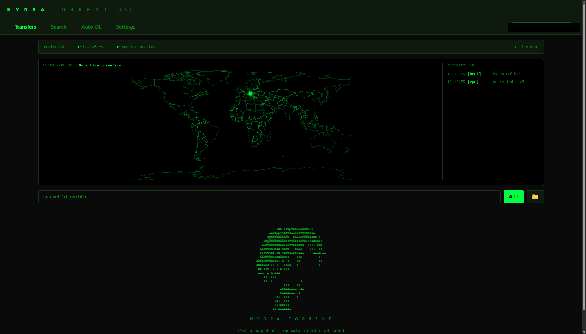
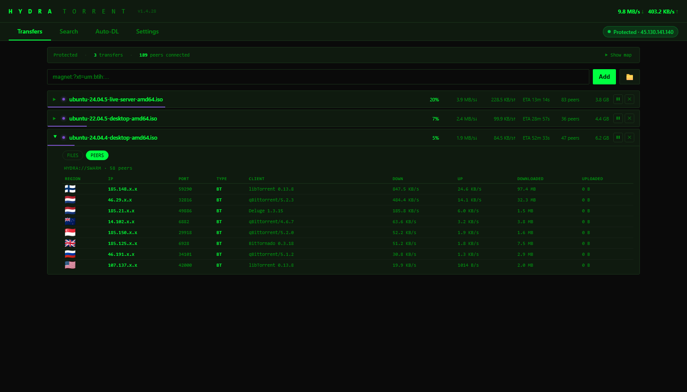
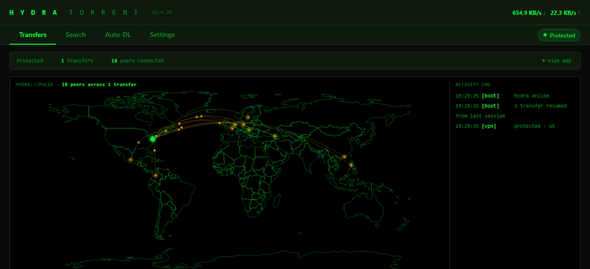
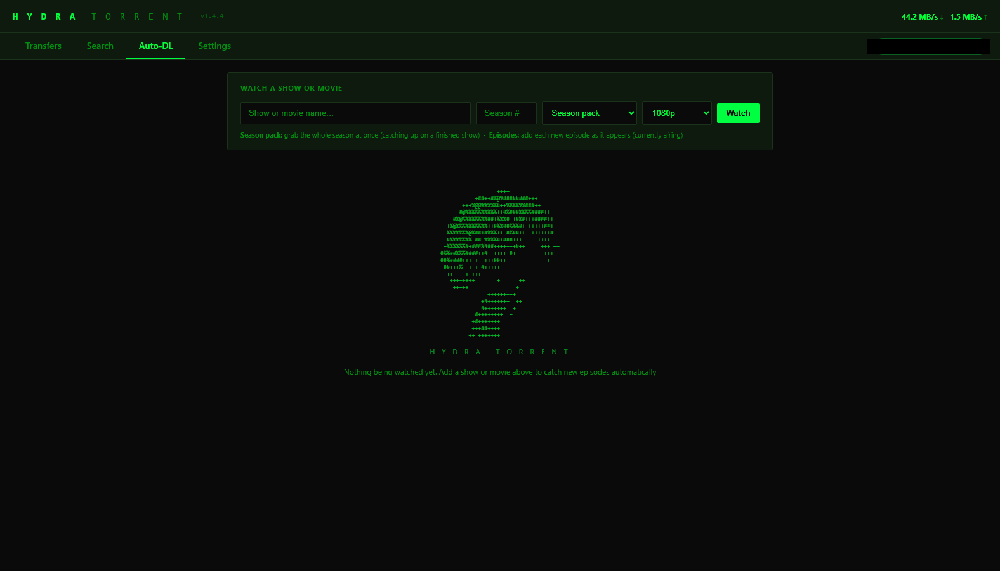
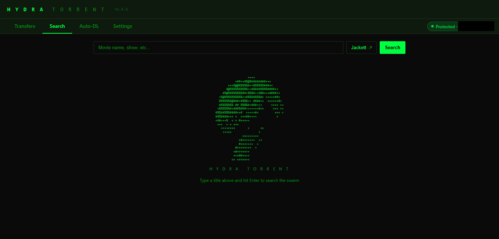
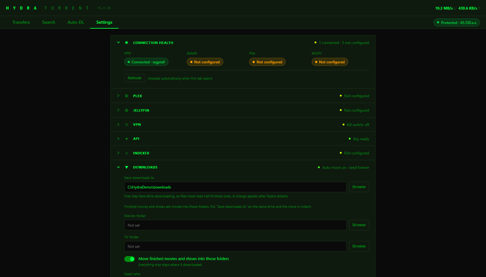
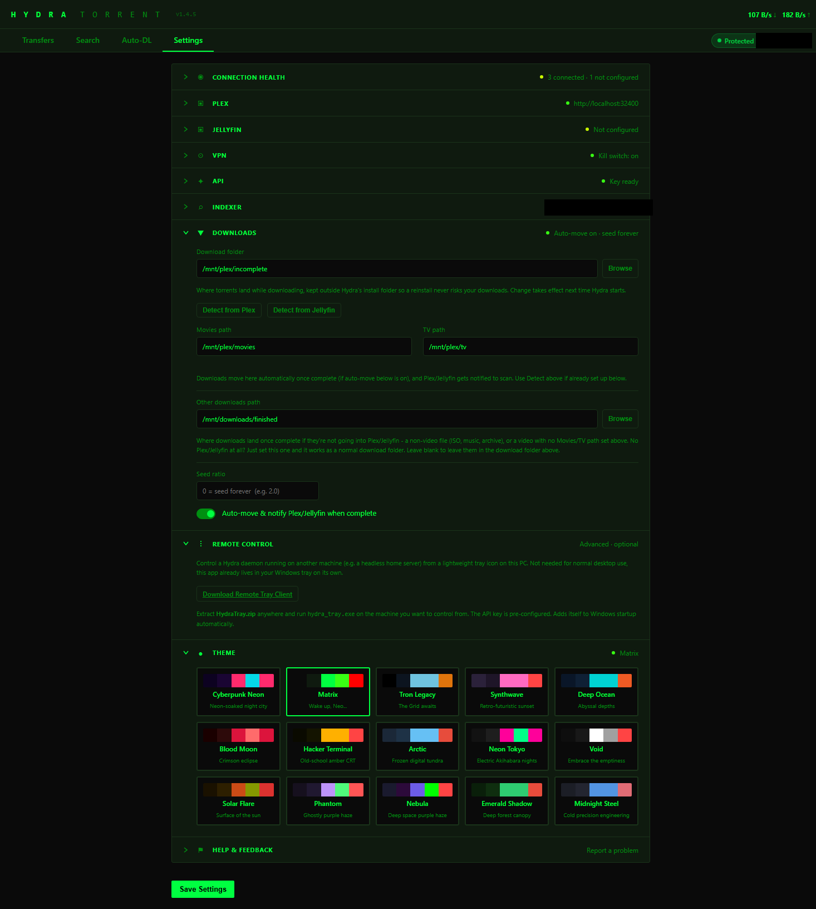

# Hydra Torrent

**A torrent client that actually protects your IP.** Auto-sorts to Plex/Jellyfin, grabs new episodes automatically, and replaces your entire qBittorrent + Sonarr + Radarr stack.

## Install

### Windows
**[>>> Download for Windows <<<](https://github.com/DelCtrlAlt33/hydra-torrent/releases/latest/download/HydraTorrent.exe)**

Double-click `HydraTorrent.exe`. It self-installs on first run - desktop shortcut, Start Menu entry, system tray icon. No Python, no dependencies, no terminal, nothing to extract.

### Docker
```bash
git clone https://github.com/DelCtrlAlt33/hydra-torrent.git
cd hydra-torrent
docker compose up -d
```
Edit `docker-compose.yml` to set your media volumes and VPN. Config is stored in `./data/`.

### Linux (Ubuntu, Debian, LXC, VM, bare metal)
```bash
git clone https://github.com/DelCtrlAlt33/hydra-torrent.git
cd hydra-torrent
sudo bash install.sh
```
Installs dependencies, creates a system user, registers a systemd service, and starts Hydra. Prints the URL when done.

**Running inside a Proxmox LXC?** Two things that are Proxmox-specific and won't show up on a normal Linux box:
- **Docker inside an LXC needs `nesting=1` enabled first** - Proxmox web UI → the LXC → Options → Features (or `pct set <vmid> --features nesting=1`). Without it, Docker either won't start or fails in confusing ways. Only matters if Hydra or Plex/Jellyfin runs via Docker inside the LXC - skip this if everything's installed natively.
- **NAS/NFS storage gets bind-mounted through Proxmox itself, not `/etc/fstab` inside the container.** Add it as a Mount Point on the LXC's Resources tab (or `pct set <vmid> --mp0 /host/path,mp=/container/path`) rather than mounting NFS from inside the LXC directly - unprivileged LXCs generally can't mount NFS themselves even if you try.

### Manual (any OS with Python 3.10+)
```bash
git clone https://github.com/DelCtrlAlt33/hydra-torrent.git
cd hydra-torrent
pip install -r requirements.txt
python hydra_daemon.py
```
Open `http://127.0.0.1:8765/ui` in your browser.

## Updating

**Windows:** the app checks GitHub on launch and shows an update badge (top-right in the browser/web UI, top-left of the title bar in the desktop app) when a newer version is out. Click it, download the new `HydraTorrent.exe`, and run it - but fully quit the running instance first (right-click the tray icon and choose Exit, not just the window's close button, which only hides it to the tray). Otherwise the still-running old version just refocuses itself and the update never applies.

**Docker:**
```bash
cd hydra-torrent
git pull
docker compose up -d --build
```
`./data` stays mounted as a volume, so config/certs/transfers survive the rebuild untouched.

**Linux:**
```bash
cd hydra-torrent
git pull
sudo systemctl restart hydra-torrent
```
No need to re-run `install.sh` - that's only for first-time setup. If a release ever adds a new dependency, run `pip install -r requirements.txt` first; if `geoip-country.mmdb` is somehow missing, `python3 fetch_geoip.py` fetches it (harmless no-op if it's already there).

**Manual:**
```bash
cd hydra-torrent
git pull
pip install -r requirements.txt
python hydra_daemon.py
```

---

**Everything works out of the box as a torrent client.** A config file is created automatically. Add Plex, Jackett, VPN whenever you want - all optional.

---





## Why Hydra?

**Your VPN drops. qBittorrent keeps downloading on your real IP.** Hydra doesn't. It auto-detects your VPN (any provider - WireGuard, OpenVPN, NordVPN, Mullvad, PIA, whatever), binds to it, and if the VPN goes down - every torrent pauses instantly. When it reconnects, they resume. Zero config, zero leaks.



**A download finishes. Now you have to move it, rename it, figure out if it's a movie or TV show, put it in the right library folder, and trigger a scan.** Hydra does all of that automatically. It detects movies vs TV vs anime, files it into the right folder, and tells Plex and/or Jellyfin to scan. Download finishes, it's in your library. Done.

**You want new episodes of a show grabbed automatically.** Set up a rule with the show name, season, and quality - Hydra checks for new releases and downloads them as they drop. No Sonarr, no Radarr, no Prowlarr, no Docker compose with 5 containers.



**Search and download in seconds.** Search your own Jackett instance, click a result, and it starts downloading - real search, real swarm, real download, watched live.



**It's one Python script and one config file.** That's the whole stack.

## Features

- Browser UI from any device on your network (phone, laptop, whatever)
- Search torrents directly from the UI (via your own Jackett instance)
- VPN kill switch - optional toggle to block all downloads without VPN
- Pick which files to download from a torrent - skip the extras
- Seed ratio limits with auto-remove
- RSS rules that grab new episodes as they drop
- Auto-sort to Plex and/or Jellyfin with library scan on completion
- HTTPS with API key auth and rate limiting
- Windows system tray app with toast notifications




### Useful commands (Linux)

```bash
sudo systemctl status hydra-torrent     # check if it's running
sudo systemctl restart hydra-torrent    # restart
sudo journalctl -u hydra-torrent -f     # view logs
```

### Troubleshooting

**`pip install libtorrent` fails?** Make sure you're on Python 3.10-3.13. Older versions don't have prebuilt packages. If you're on Linux and pip doesn't work, try `sudo apt install python3-libtorrent` instead.

**Can't connect?** Hydra runs on port 8765. Make sure nothing else is using that port. Check your firewall if accessing from another device on your network.

## VPN Kill Switch

Enable "Require VPN to download" in Settings and your real IP will never touch a peer or tracker. Hydra binds all torrent traffic directly to your VPN interface - your public IP is never used to download, upload, or connect to anything. If the VPN drops, there's nothing to fall back to. The connection is physically locked to an interface that no longer exists, so nothing can leak. Every download pauses instantly and resumes automatically when the VPN reconnects. This is the same mechanism qBittorrent, Deluge, and Transmission use - it's the industry standard approach, but Hydra does it automatically.

## VPN Setup (optional)

Install your VPN on the same machine Hydra runs on. That's it - Hydra finds it automatically.

It works with WireGuard, OpenVPN, NordVPN, Mullvad, ProtonVPN, ExpressVPN, PIA, Tailscale, Cisco AnyConnect, or anything that creates a `tun`/`tap`/`vpn` network adapter. All torrent traffic binds to the VPN interface. If the VPN drops, every torrent pauses instantly. When it reconnects, they resume.

No configuration needed in Hydra. Just get your VPN running and Hydra handles the rest.

Most VPN providers give you either a WireGuard or OpenVPN config file. Set it up on the machine where Hydra runs and Hydra handles the rest.

### PIA (Private Internet Access)

PIA's WireGuard tokens expire every 24 hours, so you need their official script to auto-reconnect:

```bash
apt install wireguard
git clone https://github.com/pia-foss/manual-connections.git
cd manual-connections
sudo PIA_USER=p1234567 PIA_PASS=your_password \
     VPN_PROTOCOL=wireguard AUTOCONNECT=true \
     PIA_PF=false PIA_DNS=true DISABLE_IPV6=yes \
     DIP_TOKEN=no ./run_setup.sh
```

To keep it running permanently, set up [pia-autoconnect-wireguard](https://github.com/j00w33/pia-autoconnect-wireguard) - it refreshes the token daily via a systemd service + cron job.

### Mullvad / ProtonVPN / NordVPN / Surfshark

These providers give you a static WireGuard config file that doesn't expire. Download it from your provider's website and:

```bash
apt install wireguard
# Save your provider's config as /etc/wireguard/wg0.conf
wg-quick up wg0
systemctl enable wg-quick@wg0   # auto-start on boot
```

### OpenVPN (works with any provider)

```bash
apt install openvpn
# Download your .ovpn file from your VPN provider
cp your-config.ovpn /etc/openvpn/client.conf
systemctl start openvpn@client
systemctl enable openvpn@client   # auto-start on boot
```

Hydra detects the VPN within seconds - check the badge in the top right of the UI.

## Search & Auto-Download (optional)

Hydra searches torrents through [Jackett](https://github.com/Jackett/Jackett) - a free app that connects to hundreds of torrent sites and gives Hydra one place to search them all. If you want search or auto-download rules to work, you need Jackett running somewhere on your network.

1. Install Jackett ([instructions](https://github.com/Jackett/Jackett#installation)) - it runs on Windows, Linux, or Docker
2. Add some indexers (torrent sites) in Jackett's web UI
3. Copy your Jackett API key from the top of Jackett's dashboard
4. In Hydra's Settings tab, paste the Jackett URL (e.g. `http://localhost:9117`) and API key

That's it - the Search tab and Auto-DL rules will work. If you don't use Jackett, everything else still works fine - you just add torrents manually via magnet links or .torrent files.

## Plex & Jellyfin (optional)

If you use Plex or Jellyfin, Hydra can automatically move completed downloads into your library and trigger a scan.

1. In Hydra's Settings tab, set your **Plex URL** (e.g. `http://localhost:32400`) and **Plex Token** - to find the token, open any media in Plex web, click "Get Info", click "View XML", and look for `X-Plex-Token=` in the URL ([Plex's guide](https://support.plex.tv/articles/204059436-finding-an-authentication-token-x-plex-token/)). For Jellyfin, set the **Jellyfin URL** and an **API key** (Dashboard → API Keys).
2. Set your **Movies path** and **TV path** - these have to be the exact same folders your Plex/Jellyfin library already points to, not just folders with similar names. Click **Detect from Plex** / **Detect from Jellyfin** to pull them automatically instead of typing them by hand.

When a download finishes, Hydra looks at the filename and figures out what it is:

- Has `S01E05`, `Season 2`, `1x05`, or episode numbers → **TV show** → moves to `TV path/Show Name/Season 01/`
- Has a year like `(2024)` → **Movie** → moves to `Movies path/Movie Name (2024)/`
- Anime with fansub tags like `[SubGroup]` → detected as TV automatically

A library scan triggers after every move, so new content shows up within seconds.

Anything auto-move can't file into a library - a non-video file (ISO, album, software archive), or a video with no Movies/TV path set - falls back to the **Other downloads path** field in the Downloads settings section instead of getting stranded. Set it if you want completed downloads moved out of the download folder; leave it blank and they just stay there.

If you don't use Plex or Jellyfin at all, skip this whole section - set only the **Other downloads path** field and it works as a normal "move everything here when done" folder, no Movies/TV paths required.

### Docker path mapping (read this if Plex/Jellyfin runs in Docker)

This is the single most common setup mistake, so it gets its own section. The short version: **auto-move only works if Hydra and your media server agree on what a folder is called.** If Plex is in Docker, Plex reports its library path as seen *inside its own container*, which is often not the real path on disk - Detect will fill it in anyway and then flag it with a warning if it doesn't check out, rather than silently pointing somewhere wrong.

Which setup you're in determines the fix:

- **Plex/Jellyfin and Hydra both installed directly on the same machine (no Docker at all).** Nothing to do - the paths already match. This is the common case for Windows users running the desktop app.

- **Plex/Jellyfin on a NAS or separate machine, Hydra elsewhere (e.g. the Windows desktop app).** Use whatever network path both can actually reach - a mapped drive letter or a UNC path like `\\nas\media\movies`. It just has to be the same share both sides are pointed at.

- **Plex/Jellyfin runs in Docker, Hydra runs natively on the same host** (installed via `install.sh`, or the desktop app on the same box) - this is the case Detect's warning is built for. Docker remaps a host folder to a different path inside the container (e.g. `/mnt/plex/movies` on the host becomes `/data/movies` inside Plex's container). Hydra needs the **host** path, not what Plex reports. Find it with:
  ```bash
  docker inspect <plex-container-name> --format '{{json .Mounts}}'
  ```
  The `"Source"` field is the real host path - use that in Hydra's Movies/TV fields instead of whatever Detect filled in.

- **Hydra itself also runs in Docker, alongside Plex/Jellyfin.** Mount the same host folder to the *same* internal container path in both services' `docker-compose.yml`. If Plex has `- /mnt/plex:/data`, give Hydra the identical line - `- /mnt/plex:/data` - not a different internal path. With matching mounts, Detect works with zero manual fixing, container or not. This is the same "consistent path mapping" principle [TRaSH-Guides](https://trash-guides.info/) recommends for Sonarr/Radarr/qBittorrent, applied to Hydra.

Rule of thumb either way: if Detect shows a green checkmark, you're done. If it shows the Docker warning, you're in one of the mixed setups above - follow the matching fix, not a guess.

## Status

Works. Runs on Docker, bare metal Linux, or Windows. Battle-tested on my homelab, shipping it for yours. Issues and PRs welcome - found something broken? Settings → Help & Feedback → **Report a Bug** opens a GitHub issue with your version, platform, and connection health already filled in, so you don't have to dig any of that up yourself.

## License

MIT

IP-to-country data for peer/VPN country flags is from [DB-IP](https://db-ip.com), licensed [CC BY 4.0](https://creativecommons.org/licenses/by/4.0/). Fetched automatically on install/build (`fetch_geoip.py`) - nothing to configure.
