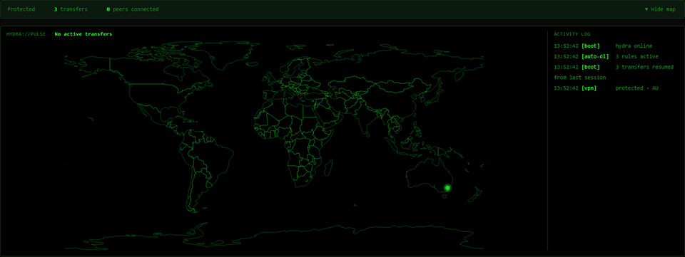

# Hydra Torrent

[](https://github.com/DelCtrlAlt33/hydra-torrent/releases)
[](#install)
[](LICENSE)
[](https://github.com/DelCtrlAlt33/hydra-torrent/commits/main)

**A BitTorrent client, built for your media server.** Search through your own Jackett, pick up new episodes with RSS rules, and have finished downloads filed into Plex or Jellyfin automatically, with a VPN kill switch built in. Free and open source.



## Install

Pick one. Everything works out of the box. Plex, search and VPN are all optional extras you can add later.

### Windows

**[Download HydraTorrent.exe](https://github.com/DelCtrlAlt33/hydra-torrent/releases/latest)** and double-click it. It installs itself (desktop shortcut, Start Menu entry, tray icon). No Python, no terminal.

Windows may show a SmartScreen warning because the exe is not code-signed. Click **More info**, then **Run anyway**.

### Docker

```bash
git clone https://github.com/DelCtrlAlt33/hydra-torrent.git
cd hydra-torrent
docker compose up -d
```

Settings and downloads live in `./data` (finished and in-progress downloads are in `./data/downloads`). The container runs as root, so those files are root-owned: use `sudo` to move or delete them, or run `sudo chown -R $USER ./data` once. If you get a permission error running `docker`, use `sudo docker compose up -d` or add yourself to the `docker` group.

### Linux (Ubuntu, Debian, LXC, VM)

```bash
git clone https://github.com/DelCtrlAlt33/hydra-torrent.git
cd hydra-torrent
sudo bash install.sh
```

It installs everything, starts Hydra as a service, and prints the address when it finishes. Running inside a Proxmox LXC? See [PROXMOX.md](PROXMOX.md).

### Any other OS (Python 3.10 to 3.13)

```bash
git clone https://github.com/DelCtrlAlt33/hydra-torrent.git
cd hydra-torrent
pip install -r requirements.txt
python hydra_daemon.py
```

### Then open it

Go to **https://localhost:8765/ui** (or the address `install.sh` printed, e.g. `https://192.168.1.50:8765/ui`).

Your browser will show a certificate warning the first time. That is expected: Hydra makes its own certificate. Choose **Advanced**, then **Proceed**. Everything else is set up in the **Settings** tab, and nothing is required.

> **Keep it on your own network.** Hydra has no login screen, like most torrent clients' web UIs on a trusted LAN. Anyone who can reach port 8765 can control it. Don't expose that port to the internet (no router port-forward, no public Docker `-p`). To reach it from outside your home, use a VPN such as WireGuard or Tailscale, or put it behind a reverse proxy that adds authentication.

## Why Hydra?

**If your VPN drops, Hydra stops.** It auto-detects your VPN (any provider: WireGuard, OpenVPN, NordVPN, Mullvad, PIA, whatever), binds to it, and if the VPN goes down every torrent pauses instantly. When it reconnects, they resume. Nothing to set up: the kill switch turns itself on the first time Hydra sees your VPN (you can switch it off in Settings, Require VPN to download). Without a VPN Hydra still works, and the header shows a red warning.


**A download finishes. Now you have to move it, rename it, figure out if it's a movie or TV show, put it in the right library folder, and trigger a scan.** Hydra does all of that automatically. It detects movies vs TV vs anime, files it into the right folder, and tells Plex and/or Jellyfin to scan.

**You want new episodes of a show grabbed automatically.** Set up a rule with the show name, season, and quality, and Hydra downloads new releases as they drop, from the same app, with nothing else to run.


**Search and download in seconds.** Search your own Jackett instance, click a result, and it starts downloading.


## Features

- Browser UI from any device on your network
- Search torrents from the UI (via your own Jackett instance)
- VPN kill switch: turns on by itself when a VPN is first detected, and pauses every download if the VPN drops
- Live peer map showing which countries your peers are in (country level, not city)
- Pick which files to download from a torrent
- Seed ratio limits with auto-remove
- RSS rules that grab new episodes as they drop
- Auto-sort to Plex and/or Jellyfin with a library scan on completion
- HTTPS (self-signed certificate) and rate limiting; no login, so keep it on your LAN or VPN
- Windows system tray app with toast notifications


## Optional setup

None of this is needed to download torrents. Add what you want, when you want it.

| I want to... | Guide |
|--------------|-------|
| Protect my IP with a VPN and the kill switch | [docs/vpn.md](docs/vpn.md) |
| Auto-file downloads into Plex or Jellyfin | [docs/plex-jellyfin.md](docs/plex-jellyfin.md) |
| Search torrents and set up auto-download rules | [docs/search-jackett.md](docs/search-jackett.md) |
| Keep my library on a NAS (SMB and NFS) | [docs/nas-storage.md](docs/nas-storage.md) |
| Run Hydra and Jackett together behind a VPN in Docker | [docs/recommended-setup.md](docs/recommended-setup.md) |
| Update to a new version | [docs/updating.md](docs/updating.md) |
| Fix a problem | [docs/troubleshooting.md](docs/troubleshooting.md) |


## Install with an AI assistant

An AI coding assistant with shell access (Claude Code, Cursor, and similar) can install Hydra for you. Give it this prompt:

```text
Install Hydra Torrent from https://github.com/DelCtrlAlt33/hydra-torrent on this machine.
Read README.md and AGENTS.md first and follow AGENTS.md. Pick the right install method for
this OS. When it is running, tell me the URL, then run the verification checklist in
AGENTS.md and report each check as pass, fail, or "could not test", with evidence.
Ask me for any tokens, keys, or paths you don't have. Do not guess them.
```

An assistant can't know your Plex token, Jackett key, VPN credentials or your real media folder paths. Have those ready. [AGENTS.md](AGENTS.md) tells it how to verify the install properly.

## Status

Works. Runs on Docker, bare-metal Linux, and Windows. Battle-tested on my homelab, shipping it for yours. Issues and pull requests are welcome on [GitHub](https://github.com/DelCtrlAlt33/hydra-torrent/issues).

## License

MIT

IP-to-country data for peer/VPN country flags is from [DB-IP](https://db-ip.com), licensed [CC BY 4.0](https://creativecommons.org/licenses/by/4.0/). Fetched automatically on install/build (`fetch_geoip.py`), so there is nothing to configure.

Country flag images in the peer list are from [flag-icons](https://github.com/lipis/flag-icons) (MIT, licence in `static/flags/LICENSE-flag-icons.txt`), bundled with Hydra and served locally.
